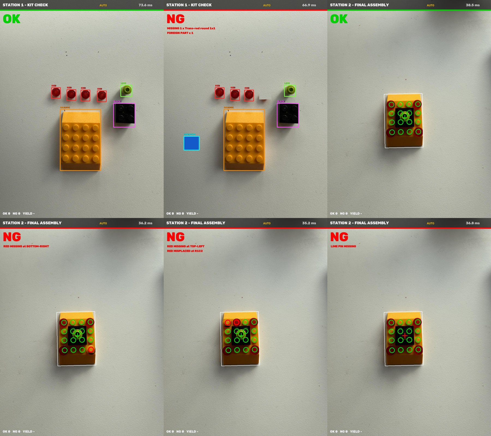
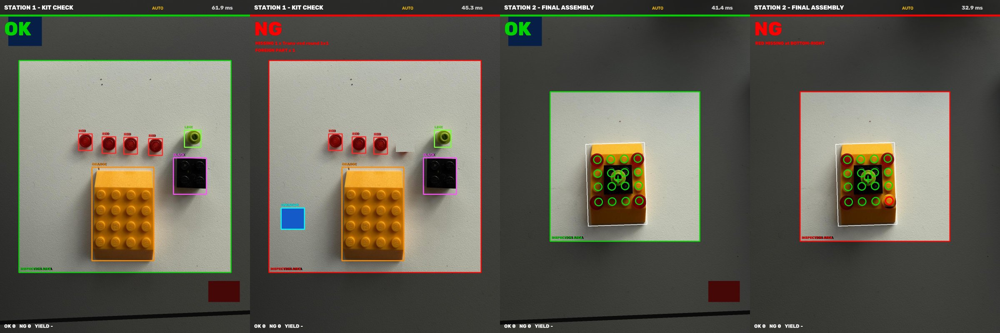

# LEGO Vision Inspection – Assembly Line Quality Control with OpenCV

A two-station machine vision inspection system built with LEGO, a webcam and Python + OpenCV.
No AI model and no training data: it uses classic machine vision (color segmentation, blob analysis
and position checks), the same principles used by industrial vision sensors.

▶️ **Watch the video:** _link coming soon_ · More projects: [chinarsoft.com](https://www.chinarsoft.com)



## What it does

| Station | Question | Method | Typical cycle time |
|---|---|---|---|
| **1 – Kit check** | Are all parts in the tray before assembly? | Separates every object from the background, classifies it by color (HSV) and compares the counts with the bill of materials | ~60 ms |
| **2 – Final assembly** | Is every part in the right place? | Finds the base, straightens it with a perspective transform, checks 16 stud positions + the center pin | ~40 ms |

Detected defects:

- Missing part, extra part, foreign part in the kit tray
- Red stud missing from a corner
- Red stud placed on the wrong stud
- Black brick missing or shifted
- Lime pin missing
- Part rotated 180° is still accepted (both orientations are checked)

### Inspection area

Only objects inside the square in the middle of the image are inspected. Everything outside is
dimmed and ignored, and objects touching the edge of the square are ignored too, so cables, table
edges and hands at the border do not cause false results.



## Quick start (macOS / Linux / Windows)

```bash
git clone https://github.com/tahsin-chinarsoft/lego-vision-inspection.git
cd lego-vision-inspection
python3 -m venv .venv
source .venv/bin/activate          # Windows: .venv\Scripts\activate
pip install -r requirements.txt

# Try it on the sample photos (no camera needed)
python3 lego_inspect.py --image samples/kit_ok.jpg --station 1 --roi 0.85
python3 lego_inspect.py --image samples/assembly_ng_missing_red.jpg --station 2

# Live with a webcam
python3 lego_inspect.py --camera 0
```

On macOS, allow camera access for Terminal: **System Settings → Privacy & Security → Camera**.
Click the video window once before using the keys.

### Options

| Option | Default | Description |
|---|---|---|
| `--camera N` | 0 | Camera index (try 1 for an external camera) |
| `--station N` | 1 | Start station (1 = kit, 2 = assembly) |
| `--roi X` | 0.6 | Inspection area size, as a fraction of the image height |
| `--width N` | 1280 | Window width in pixels |
| `--image FILE` | – | Inspect a photo instead of the camera |
| `--out FILE` | – | With `--image`: save the result image and exit |

### Keys

| Key | Action |
|---|---|
| `1` / `2` | Station 1 (kit) / Station 2 (assembly) |
| `a` | AUTO (live) ↔ TRIGGER mode |
| `SPACE` | Trigger: inspect, count OK/NG, log to `inspection_log/log.csv` and save an image |
| `↑` / `↓` (or `+` / `-`) | Inspection area bigger / smaller |
| `i` `j` `k` `l` | Move the inspection area (up / left / down / right) |
| `c` | Center the inspection area |
| `g` | Show / hide the stud grid |
| `m` | Color mask view (calibration) |
| `f` | Full screen |
| `r` | Reset counters |
| `q` / `ESC` | Quit |

## Setup tips

- Mount the camera **straight above** the part and keep it fixed.
- Use a **matte white background**.
- Light from **both sides at about 45°**. Shadows are the most common cause of false NG results.
- Lock the camera's auto exposure and white balance if you can.
- In the kit tray, parts must **not touch each other**, otherwise they are counted as one object.

## Calibration

All settings are at the top of `lego_inspect.py`:

- `COLORS` – HSV ranges per color. Press `m` to see the masks; every part should appear in its own color on a black background.
- `BOM` – the bill of materials for station 1 (color → expected count).
- `GRID_X`, `GRID_Y`, `EXPECTED` – stud positions and the expected color of each stud for station 2.
- `ROI_SIZE` – default size of the inspection area.

To inspect your own product, change `BOM` and `EXPECTED`, then adjust `GRID_X` / `GRID_Y` with the
`g` key until the circles sit on the studs.

## How it works

1. **Segmentation** – every pixel that is not the white background is an object.
2. **Color classification** – HSV thresholds decide the dominant color of each object or inspection window.
3. **Station 1** – contours are counted per color and compared with the bill of materials.
4. **Station 2** – the base is found with `minAreaRect`, straightened with a perspective transform,
   and each of the 16 studs is checked in a small circular window. Both 0° and 180° orientations are
   tried and the better match is used.

## Next steps

- The same problem solved with a trained YOLO model on a Jetson
- Comparison: classic vision vs. YOLO vs. an AI vision model

## License

MIT – see [LICENSE](LICENSE). LEGO® is a trademark of the LEGO Group, which does not sponsor or endorse this project.
